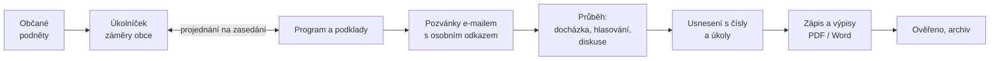

# Konšel

Systém pro přípravu a vedení zasedání zastupitelstva a rady obce – **od programu po ověřený zápis** – s úkolníčkem dlouhodobých záměrů a stránkou pro občany.

Nette 3.3 · Doctrine ORM 3 · Latte · Bootstrap 5.3 · Vite · SQLite (později MySQL) · vše v Dockeru.



## Rychlý start

Potřebujete jen Docker.

```bash
make up          # kontejnery: aplikace :8080, Mailpit :8025, Vite watch
make db-reset    # databáze + demo data (vypíše účty a odkaz zastupitele)
```

- Aplikace: http://localhost:8080 (rozcestník Jsem občan / Jsem zastupitel)
- Administrace: http://localhost:8080/prihlaseni – účet `spravce@demo.konsel.test`, heslo vypíše `make db-reset`
- E-maily z aplikace: http://localhost:8025
- Wiki v aplikaci: http://localhost:8080/admin/help

Před commitem vždy `make qa` (coding standard, PHPStan, testy). Všechny příkazy: `make help`.

## Dokumentace (wiki)

Wiki je v [`doc/wiki/`](doc/wiki/) a stejné stránky se zobrazují v aplikaci v menu **Nápověda** (včetně diagramů).

| Kapitola | O čem |
|---|---|
| [Rychlý start](doc/wiki/01-rychly-start.md) | spuštění, příkazy, demo, kde co je |
| [Jak systém funguje](doc/wiki/02-jak-system-funguje.md) | role, zasedání krok za krokem, úkolníček a občané |
| [Moduly a propojení](doc/wiki/03-moduly-a-propojeni.md) | mapa modulů, **úkolníček vs. úkoly z usnesení** |
| [Životní cykly](doc/wiki/04-zivotni-cykly.md) | stavy zasedání, hlasování, usnesení, úkolů, docházky, odkazů |
| [Architektura](doc/wiki/05-architektura.md) | vrstvy, co se stane po kliknutí, složky, tenancy, oprávnění |
| [Doctrine pro začátečníky](doc/wiki/06-doctrine.md) | entity, EntityManager, flush, dotazy, migrace |
| [Frontend: Vite, Bootstrap, Naja](doc/wiki/07-frontend-vite.md) | jak se sestavuje CSS/JS, AJAX snippety, kontrola vzhledu |
| [Testy a kvalita](doc/wiki/08-testy-a-kvalita.md) | `make qa`, druhy testů, pomocníci |
| [Plán a stav](doc/wiki/09-plan-a-stav.md) | co je hotové, co zbývá, dluhy |
| [Nasazení a provoz](doc/wiki/10-nasazeni-a-provoz.md) | konfigurace, nasazení, cron, zálohy |

Další dokumenty:

- [`doc/todo-v2.md`](doc/todo-v2.md) – plán po taskách, architektonická rozhodnutí (ADR) a **Deník** změn
- [`doc/todo-v1.md`](doc/todo-v1.md) – doménové požadavky
- [`doc/permissions.md`](doc/permissions.md) – matice oprávnění
- [`CLAUDE.md`](CLAUDE.md) – pravidla kódu a slovníček česky ↔ anglicky

## Struktura v kostce

```
app/Model/<Doména>/      entity, fasády, repozitáře – pravidla obce a zasedání
app/AdminModule/         administrace úřadu (presenter + šablony v jedné složce)
app/PortalModule/        portál zastupitele (osobní odkaz)
app/PublicModule/        úvod, přihlášení, podněty občanů
app/UI/, app/Core/       sdílené UI a infrastruktura
assets/                  JS + SCSS → Vite → www/assets
migrations/              změny databáze
resources/documents/     šablony PDF (pozvánka, zápis, usnesení…)
resources/mail/          šablony e-mailů
tests/                   unit a integrační testy
doc/                     plán, oprávnění, wiki
```

## Licence

Interní projekt, zatím bez licence.
