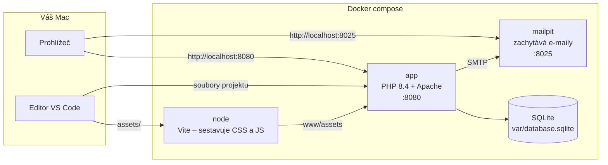

# Rychlý start

Jak Konšel spustit, vyzkoušet a s čím budete denně pracovat.

## Co je potřeba

Na počítači stačí **Docker** (Docker Desktop). PHP, databáze, Node i poštovní server běží v kontejnerech – na Mac se nic neinstaluje. Všechny příkazy se spouští přes `make` v kořeni projektu.



## První spuštění

```bash
make up          # nastartuje kontejnery (poprvé chvíli trvá)
make db-reset    # vytvoří databázi a nahraje demo data
```

Pak otevřete:

| Adresa | Co tam je |
|---|---|
| http://localhost:8080 | úvodní stránka – rozcestník Jsem občan / Jsem zastupitel |
| http://localhost:8080/prihlaseni | přihlášení úřadu |
| http://localhost:8080/obec/neplachovice/podnety | stránka pro občany |
| http://localhost:8025 | Mailpit – všechny e-maily, které aplikace „odešle“ |
| http://localhost:8080/admin/help | tato wiki přímo v aplikaci |

Demo účty (heslo vypíše `make db-reset` na konci výpisu):

| E-mail | Role |
|---|---|
| `spravce@demo.konsel.test` | správce obce – vidí a smí všechno |
| `editor@demo.konsel.test` | editor – připravuje zasedání, zapisuje průběh |
| `ctenar@demo.konsel.test` | čtenář – jen náhled |
| `superadmin@demo.konsel.test` | správce systému (všechny obce) |

`make db-reset` na konci vypíše i **osobní odkaz zastupitele** (`/odkaz/…`) – otevřete ho v anonymním okně a uvidíte portál zastupitele.

## Příkazy, které budete používat

| Příkaz | K čemu |
|---|---|
| `make up` / `make down` | zapnout / vypnout kontejnery |
| `make db-reset` | smazat databázi, spustit migrace, nahrát demo data |
| `make qa` | **před každým commitem**: coding standard + PHPStan + testy |
| `make test` | jen testy |
| `make cs-fix` | automaticky opraví formátování kódu |
| `make console ARGS="…"` | konzolové příkazy (viz níže) |
| `make composer ARGS="require …"` | PHP balíčky |
| `make npm ARGS="install …"` | JS balíčky |
| `make sh` | shell uvnitř PHP kontejneru |
| `make screenshots PAGES="/admin,…"` | screenshoty stránek (desktop + mobil) do `temp/screenshots` |
| `make logs` | logy kontejnerů |
| `make backup` | záloha databáze a souborů do `var/backups` |

Konzolové příkazy (`make console ARGS="…"`):

| Příkaz | K čemu |
|---|---|
| `migrations:migrate` | spustí nové migrace databáze |
| `app:seed-demo` | demo data do prázdné databáze |
| `municipality:create` / `municipality:list` | založení / výpis obcí |
| `user:create` | založení uživatele úřadu |
| `app:encryption-key` | vygeneruje šifrovací klíč (pro API klíč OpenAI) |
| `locks:cleanup` | smaže vypršelé zámky bodů (do cronu) |
| `search:reindex` | postaví fulltextový index znovu z dat (index se jinak aktualizuje sám) |
| `backup:run` | záloha (`--db-only` jen databáze, `--scheduled` jen podle plánu – do cronu každou hodinu) |

## Kde co je

```
app/
├── Model/<Doména>/        doména: entity, fasády, repozitáře (to hlavní)
├── AdminModule/<Stránka>/ administrace úřadu – presenter + šablony v jedné složce
├── PortalModule/          portál zastupitele (přístup osobním odkazem)
├── PublicModule/          veřejné stránky: úvod, přihlášení, podněty občanů
├── UI/                    sdílené části UI: formuláře, menu, diskuse, téma
└── Core/                  infrastruktura: routování, oprávnění, Doctrine, Latte
assets/                    JS a SCSS (Vite je sestaví do www/assets)
migrations/                změny databáze
resources/documents/       šablony PDF dokumentů (pozvánka, zápis…)
resources/mail/            šablony e-mailů
tests/                     testy
doc/                       plán (todo-v2.md), oprávnění, tato wiki
```

Podrobně v kapitole [Architektura](05-architektura.md).

## Vývoj krok za krokem

1. Změníte PHP nebo Latte → stačí obnovit stránku.
2. Změníte `assets/*.js` nebo `*.scss` → kontejner `node` je sám sestaví (Vite watch), obnovte stránku.
3. Změníte entitu → napíšete migraci (viz [Doctrine](06-doctrine.md)) a `make console ARGS="migrations:migrate"`.
4. `make qa` musí být zelené.
5. Commit.
