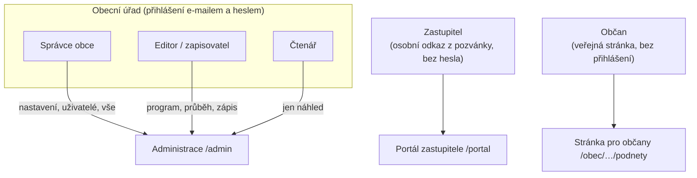
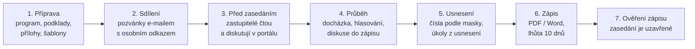

# Jak systém funguje

Konšel provede obec celým životem zasedání: **program → podklady → pozvánka → průběh → usnesení → zápis → archiv**. K tomu má plány pro dlouhodobé záměry a stránku pro občany.

## Kdo s Konšelem pracuje

| Kdo | Kde | Co dělá |
|---|---|---|
| Správce obce | Administrace | všechno: nastavení obce, barvy, uživatelé, revokace usnesení, znovuotevření zasedání |
| Editor | Administrace | připravuje zasedání, zapisuje docházku, hlasování a diskusi, úkoly |
| Čtenář | Administrace | jen čte |
| Zastupitel | Portál | čte program a podklady, stahuje dokumenty, diskutuje k bodům a u plánů |
| Občan | Veřejná stránka | vidí zveřejněné plány obce (fáze, priorita, veřejné komentáře), posílá podněty |

## Zasedání od začátku do konce

### 1. Příprava (stav *V přípravě*)
- **Zasedání → Nové zasedání**: orgán, datum, místo, typ (řádné, mimořádné, ustavující).
- Program: body ručně, ze **šablony programu**, nebo „Vložit standardní body“ (zahájení, ověřovatelé, schválení programu, diskuse, závěr). Pořadí se mění přetažením.
- **Podbody**: tlačítkem + u bodu přidáte podbod (např. 26 Nájemní bydlení → 26.1 schválení projektu, 26.2 dodavatele, 26.3 peněz). O každém podbodu se hlasuje zvlášť a má vlastní usnesení; bod s podbody sám hlasování nemá. Podbody se při přesunu drží pod svým bodem.
- U bodu: důvodová zpráva, **návrh usnesení** (pomůže knihovna šablon usnesení), předkladatel, přílohy (PDF, Word…), propojení s plánem.
- **Funkce**: předsedající, zapisovatel, ověřovatelé.

### 2. Sdílení (stav *Sdíleno*)
- **Pozvánky a odkazy → Sdílet a rozeslat pozvánky**: zasedání se sdílí a každý člen orgánu dostane e-mail s osobním odkazem do portálu, programem a PDF pozvánky. Kdo nemá e-mail, tomu se odkaz ukáže k předání jinak.
- Přehled odeslaných e-mailů včetně chyb. Pozvánku jde poslat znovu jednomu členovi.
- Dokumenty: **informace o konání zasedání** k vyvěšení na úřední desku (§ 93), **podklady**, **prezenční listina**.
- **Uložit verzi do archivu**: PDF v současné podobě se uloží natrvalo – typicky pozvánka v den vyvěšení (demo to ukazuje u sdíleného zasedání).

- **AI asistent** (je-li v Nastavení → Umělá inteligence zadaný klíč): u důvodové zprávy a návrhu usnesení je tlačítko **Navrhnout pomocí AI**. Navrhne text podle názvu bodu, nadřazeného bodu a toho, co už je napsané, a drží se **pokynů a vzorů obce** (Nastavení → Umělá inteligence → Pokyny a vzory; jako vzory slouží i poslední usnesení obce). Návrh se jen vloží do pole a jde vrátit – uloží se až s formulářem. Osobní údaje členů se neposílají.

### 3. Před zasedáním
- Zastupitelé v portálu čtou podklady a diskutují u bodů (formátovaný text, soubory přetažením). Úřad vidí diskusi u bodu v administraci.

### 4. Průběh (stav *Probíhá*) – obrazovka **Průběh zasedání**
- **Docházka**: přítomen / omluven / neomluven, „Ostatní přítomni“, pozdní příchod a odchod. Ukazatel **usnášeníschopnosti** se mění okamžitě.
- **Hlasování** u bodu: „Hlasovat o návrhu usnesení“ (nebo protinávrh, pozměňovací návrh, volba osoby), matice přítomných, „Všichni přítomní pro“, výjimky, „Ukončit hlasování“ → přijato / nepřijato.
- **Diskuse do zápisu** u každého bodu – ukládá se sama.
- Doplnění bodu do programu během zasedání (o doplnění se hlasuje při schválení programu).
- Dva lidé najednou: kdo píše diskusi, ten ji „drží“, druhý ji vidí jen ke čtení. Obrazovka se každých 5 s sama obnovuje.

### 5. Usnesení
- Přijaté hlasování o návrhu, protinávrhu nebo volbě vytvoří **usnesení s číslem** podle masky orgánu (např. `{n}/{yyyy}` → `9/2026`).
- S podbody: maska `{n}/{meeting}[/{sub}]` dá `26/2/1`, `26/2/2`… (všechna usnesení jednoho bodu sdílejí pořadové číslo) a u bodu bez podbodů `22/2` – část v hranatých závorkách se vypíše jen u podbodu. Tak čísluje demo (vzor obce Neplachovice).
- Zavádíte Konšel v průběhu období? V Osoby a orgány → Upravit orgán nastavte **pokračovat od čísla** (např. 27).
- K usnesení se přidávají **úkoly z usnesení** (kdo, do kdy). Úkoly po termínu se zvýrazní na přehledu.

### 6. Zápis (stav *Ukončeno*)
- **Dokumenty → Zápis ze zasedání**: všechny náležitosti podle § 95, i s jmenovitým hlasováním, PDF nebo verze pro Word.
- Přehled hlídá **lhůtu 10 dnů** na vyhotovení zápisu.
- Dále: **usnesení ze zasedání** (s podpisy), **výpis z jednoho usnesení**.

- **Záznam zasedání**: v detailu zasedání pod Funkcemi tlačítkem + (nebo přetažením) nahrajete zvukový záznam – MP3 a další formáty, až 500 MB na soubor, i více souborů (před a po přestávce). Přehrává se přímo v prohlížeči. Přepis záznamu zatím není.

### 7. Ověření zápisu (stav *Zápis ověřen*)
- Po ověření zápisu už nejde měnit program, podklady, diskuse, docházka, hlasování ani funkce – zasedání je v **archivu**.
- Najde-li se chyba, správce zvolí **Zrušit ověření zápisu** a napíše důvod. Zasedání se vrátí do stavu *Ukončeno*, opraví se a zápis se ověří znovu. Důvod zůstane v historii zasedání.
- Konečný **zápis a usnesení se samy uloží do archivu** (Dokumenty → Archiv dokumentů). Naskenovaný **podepsaný originál** nahrajete tamtéž jako PDF.
- Archiv ověřeného zasedání je jen pro přidávání – verze nejde smazat.
- Menu **Archiv**: zasedání podle let a orgánů s konečným (nebo podepsaným) zápisem a usnesením na jedno kliknutí; neověřená zasedání jsou označená „čeká na ověření zápisu“ i se lhůtou.

## Plány a občané

- **Plány** drží dlouhodobé záměry obce („postavit školu“, „oprava komunikace“) v jednom vlákně: změny fáze, diskuse, soubory a **všechna zasedání**, na kterých se o něm jednalo, včetně přijatých usnesení.
- **Občan** pošle podnět na veřejné stránce → vznikne úkol ve fázi *nový podnět* → úřad dostane e-mail → po posouzení ho může zveřejnit. Občan pak vidí fázi, prioritu a komentáře označené „vidí občané“.

## Hledání

Pole **Hledat** v horní liště (nebo menu Hledat) prohledá zasedání, body programu, usnesení, diskuse, plány i šablony. Na diakritice a velikosti písmen nezáleží a stačí začátek slova: „smlouva o dilo“ najde „Smlouva o dílo“, „rozpoč“ najde „rozpočtové opatření“. Výsledky jdou zúžit podle druhu, orgánu a roku a shody jsou zvýrazněné.

Jak spolu plány, usnesení a úkoly z usnesení souvisí, popisuje kapitola [Moduly a propojení](03-moduly-a-propojeni.md).
