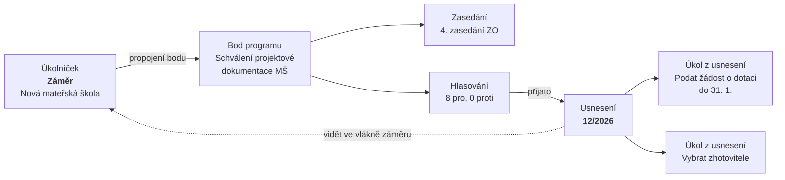
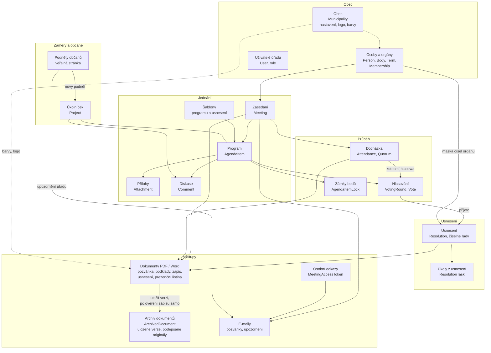
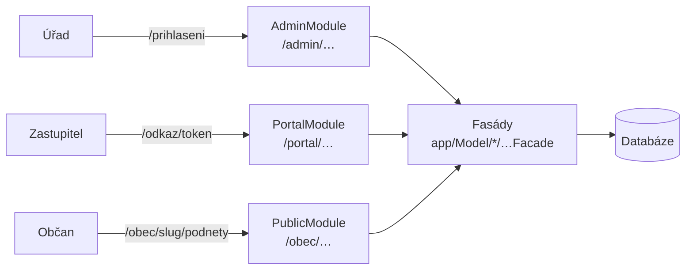

# Moduly a jejich propojení

## Úkolníček vs. Úkoly z usnesení – v čem je rozdíl

Obojí zní jako „úkoly“, ale jde o dvě různé věci, které na sebe navazují:

| | **Úkolníček** (`Project`) | **Úkoly z usnesení** (`ResolutionTask`) |
|---|---|---|
| Co to je | dlouhodobý **záměr** obce | konkrétní **povinnost**, kterou uložilo usnesení |
| Příklad | „Nová mateřská škola“, „Oprava komunikace Za Školou“ | „Starosta podepíše smlouvu o dílo do 15. 11.“ |
| Jak dlouho žije | měsíce až roky, prochází fázemi (námět → příprava → projekt → schváleno → realizace → hotovo) | dny až týdny, je otevřený → splněný / zrušený |
| Kdo ho zakládá | úřad, nebo občan podnětem | úřad u přijatého usnesení |
| Kde ho najdu | menu **Úkolníček** | menu **Úkoly z usnesení**, přehled, detail usnesení |
| Vidí ho občan | ano, pokud je zveřejněný | ne |

Stavy obou (fáze záměru, otevřený / splněný úkol) popisuje kapitola [Životní cykly](04-zivotni-cykly.md).

**Jak se potkávají:** záměr z úkolníčku se projedná na zasedání (bod programu je s ním propojený) → zastupitelstvo hlasuje → vznikne **usnesení** → usnesení může uložit **úkoly**. Ve vlákně záměru pak vidíte, na kterém zasedání se o něm jednalo a jaké usnesení padlo.

## Mapa modulů

## Moduly jeden po druhém

| Modul | Doména (`app/Model/…`) | Obrazovky | K čemu |
|---|---|---|---|
| Obec | `Municipality` | Nastavení (údaje, vzhled, AI) | údaje do hlaviček dokumentů, logo, **barvy obce** |
| Uživatelé | `User` | Uživatelé, Můj účet | přihlášení úřadu, role čtenář / editor / správce |
| Osoby a orgány | `People` | Osoby a orgány | zastupitelé, orgány (zastupitelstvo, rada, výbory), volební období, členství, **maska číslování usnesení** |
| Zasedání | `Meeting` | Zasedání, detail (Program / Průběh / Usnesení / Dokumenty) | životní cyklus zasedání, program, funkce |
| Průběh | `Meeting` (Attendance, VotingRound, AgendaItemLock) | Průběh zasedání | docházka, usnášeníschopnost, hlasování, diskuse do zápisu |
| Přílohy | `Attachment` | u bodu, v diskusi, u úkolu | soubory v úložišti, kontrola typu a velikosti |
| Diskuse | `Comment` | u bodu, v úkolníčku, v portálu | formátovaný text, soubory, odpovědi, viditelnost pro občany |
| Šablony | `Template` | Šablony | šablony programu (řádné, ustavující) a knihovna usnesení |
| Usnesení | `Resolution` | Usnesení, detail | čísla, znění, stav, revokace, výpis |
| Úkoly z usnesení | `Resolution` (ResolutionTask) | Úkoly z usnesení, přehled | termíny, splnění, po termínu |
| Úkolníček | `Project` | Úkolníček | dlouhodobé záměry, fáze, vlákno |
| Podněty občanů | `Project` | veřejná stránka obce | podnět → úkolníček, zveřejněné úkoly |
| Odkazy zastupitelů | `Access` | Pozvánky a odkazy | osobní odkaz do portálu (v DB jen otisk) |
| E-maily | `Mail` | Pozvánky a odkazy | pozvánky, upozornění na podnět, záznam odeslání |
| Dokumenty | `Document` | Dokumenty u zasedání, výpis u usnesení | PDF přes mPDF, verze pro Word |
| Archiv | `Document` (ArchiveEntry) | menu Archiv | proběhlá zasedání podle let a orgánů, konečný zápis a usnesení |
| Archiv dokumentů | `Document` (ArchivedDocument) | Dokumenty → Archiv dokumentů | uložené verze PDF, konečný zápis po ověření, podepsané skeny; po ověření jen přidávat |
| AI | `Ai` | Nastavení → Umělá inteligence | napojení na OpenAI (klíč šifrovaně) |
| Hledání | `Search` | Hledat (menu a pole v horní liště) | fulltext bez diakritiky v zasedáních, bodech, usneseních, diskusích, úkolníčku a šablonách |
| Nápověda | – (`doc/wiki`) | Nápověda | tato wiki |

## Tři vstupy do aplikace

Všechny tři vstupy používají **stejné fasády** – pravidla (kdo smí hlasovat, kdy jde měnit program…) jsou proto na jednom místě a platí všude.
