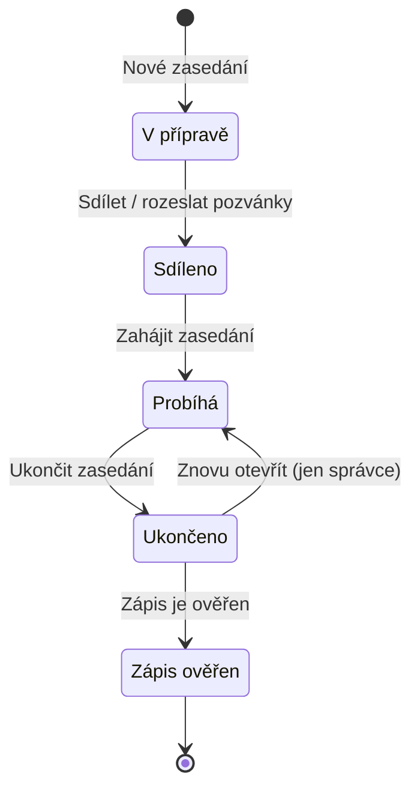
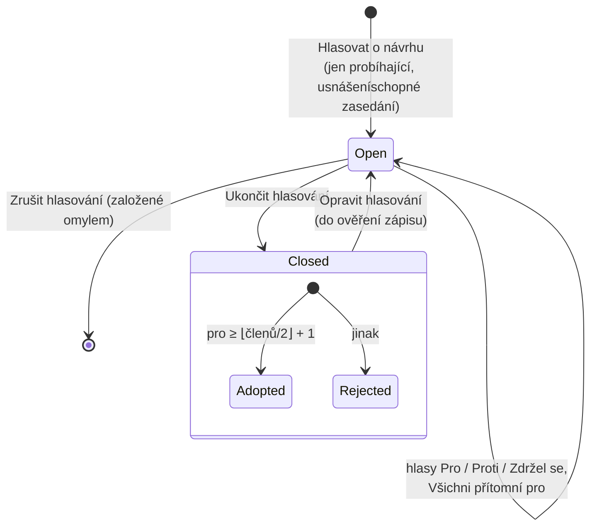
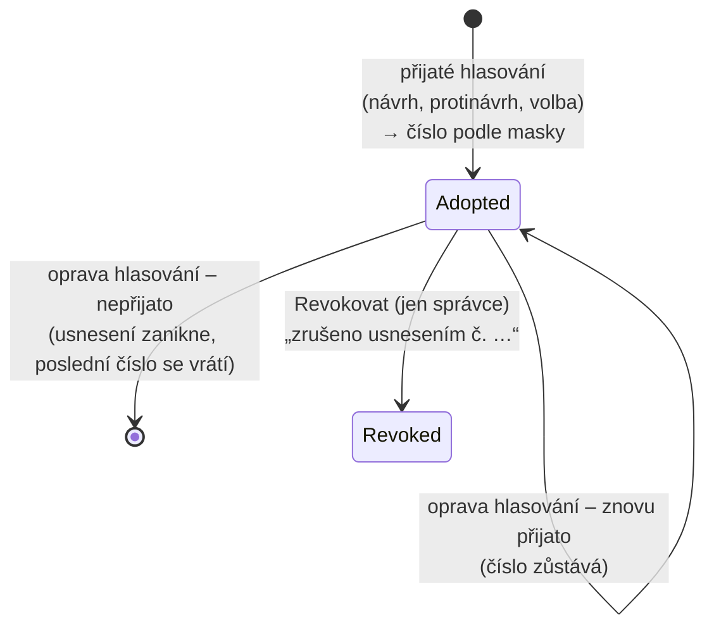
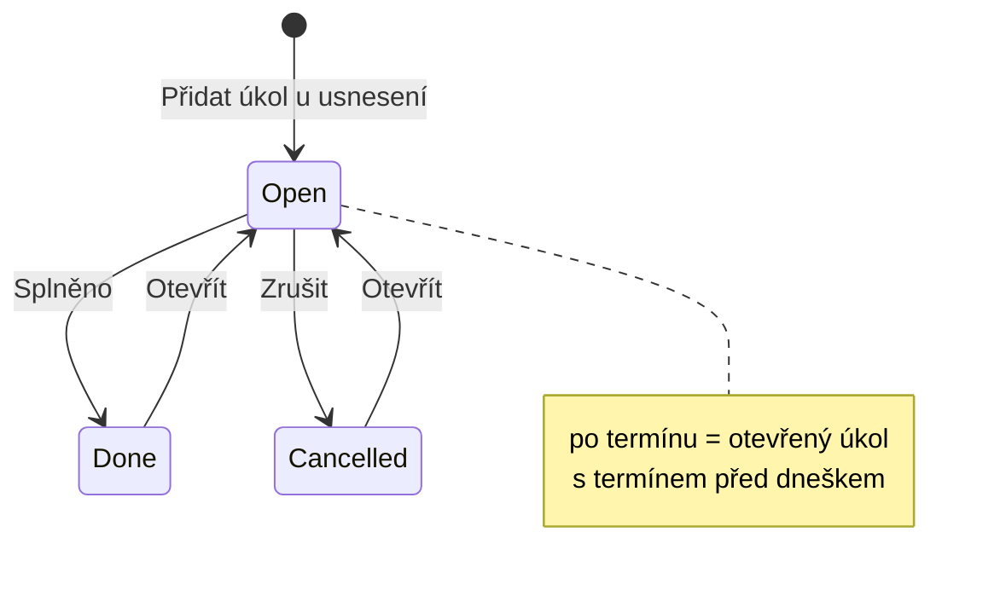
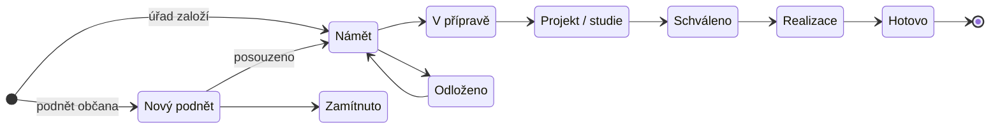
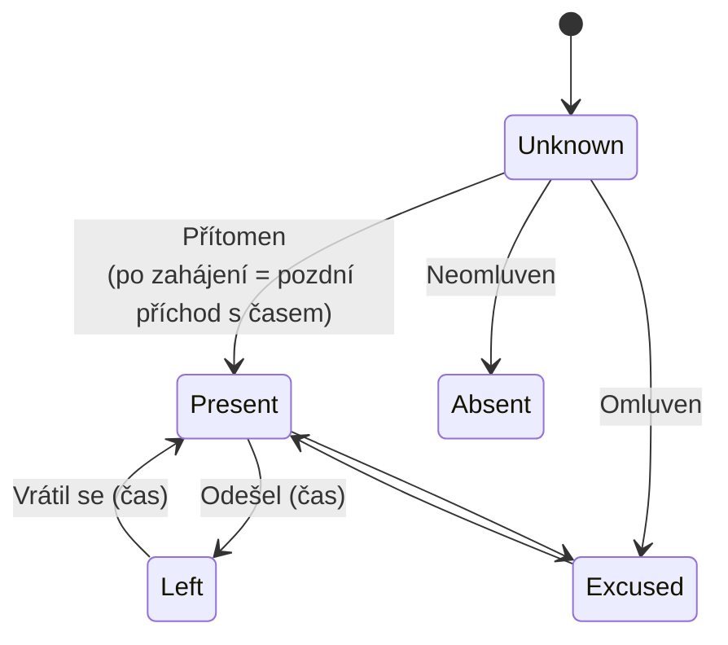
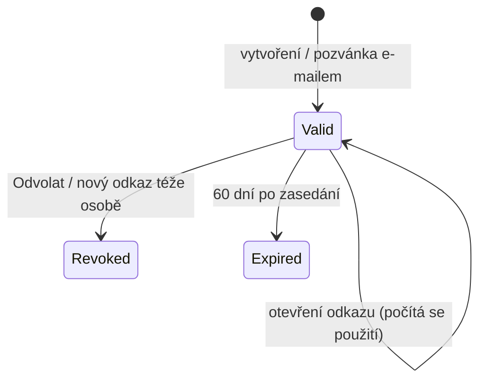
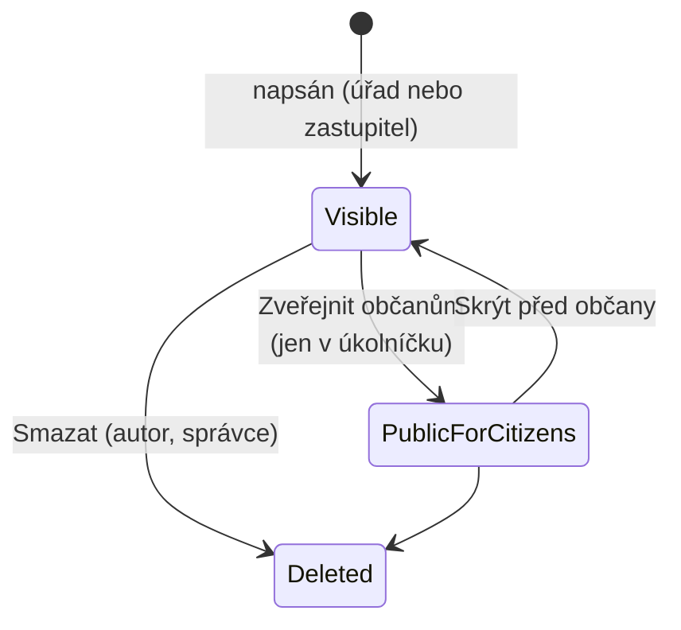

# Životní cykly

Každá důležitá věc v Konšelu má **stavy** a jasná pravidla, kdy se smí přejít do dalšího. Pravidla hlídá přímo entita v `app/Model` – nejde je obejít ani z jiné obrazovky.

## Zasedání (`Meeting`, `MeetingStatus`)

| Stav | Program | Přílohy, diskuse | Docházka | Hlasování | Diskuse do zápisu | Dokumenty |
|---|---|---|---|---|---|---|
| V přípravě | měnit | ano | – | – | – | pozvánka, podklady, prezenční listina |
| Sdíleno | měnit | ano | zapisovat | – | – | + pozvánky e-mailem |
| Probíhá | jen „doplnit bod“ | ano | zapisovat | **hlasovat** | zapisovat | + zápis a usnesení (koncept) |
| Ukončeno | – | ano | opravovat | opravovat | opravovat | zápis, usnesení, výpisy; běží lhůta 10 dnů |
| Zápis ověřen | – | – | – | – | – | vše jen ke čtení |

Smazat jde jen zasedání v přípravě. Sdílení zasedání méně než 7 dní předem zobrazí varování (§ 93 – vyvěšení na úřední desce).

## Hlasování (`VotingRound`)

- Hlasují jen členové **přítomní v okamžiku zahájení** hlasování (podle docházky).
- Výsledek počítá `VotingRule`: přijato, když hlasů pro je víc než polovina **všech** členů orgánu (§ 87), ne jen přítomných. Zdržel se = fakticky ne.
- Po přijetí návrhu nebo protinávrhu se o dalším návrhu k bodu nehlasuje.

## Usnesení (`Resolution`)

Číslo přiděluje číselná řada orgánu (rok / volební období / zasedání) atomicky – dvě současná hlasování nikdy nedostanou stejné číslo.

## Úkol z usnesení (`ResolutionTask`)

## Úkol v úkolníčku (`Project`, `ProjectStatus`)

Fázi lze přepnout na libovolnou (s poznámkou) – každá změna se zapíše do vlákna. Občan vidí jen **zveřejněné** úkoly; nový podnět je neveřejný, dokud ho úřad nezveřejní.

## Docházka (`Attendance`)

Usnášeníschopnost (`Quorum`): přítomna nadpoloviční většina **počtu míst** orgánu – u 9členného zastupitelstva alespoň 5.

## Osobní odkaz zastupitele (`MeetingAccessToken`)

V databázi je jen otisk (SHA-256) – samotný odkaz se ukáže jen při vytvoření nebo odejde e-mailem.

## Komentář (`Comment`)

Smazaný komentář s odpověďmi zůstane jako „Komentář byl smazán“, aby vlákno dávalo smysl. Diskuse u bodu se uzavře ověřením zápisu.
