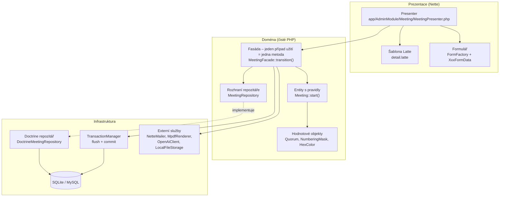
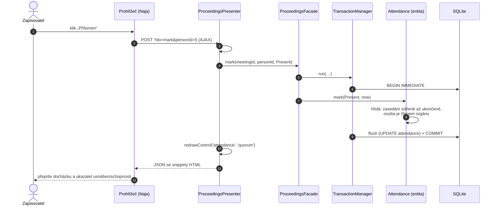
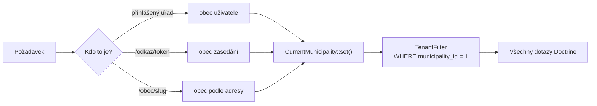

# Architektura

## Vrstvy

Kód je rozdělený do vrstev. Každá vrstva smí volat jen tu pod sebou – díky tomu je jasné, kde co hledat a co se dá bezpečně měnit.



**Pravidla, která drží pořádek:**

1. **Presenter nikdy nesahá do databáze.** Volá jen fasády (`App\Model\*\*Facade`).
2. **Pravidla jsou v entitách.** `$meeting->start($clock)` místo `$meeting->setStatus(...)`. Entita sama vyhodí výjimku, když akce není povolená.
3. **Jedna metoda fasády = jedna transakce** přes `TransactionManager::run()`.
4. **Doména nezávisí na Nette.** Vstupy jsou jednoduché objekty (`Command/SaveMeeting`), soubory `UploadedFile`.
5. **Externí služby jsou rozhraní** (`Mailer`, `PdfRenderer`, `AiClient`, `FileStorage`) s implementací vedle (`NetteMailer`, `MpdfRenderer`…). V testech se podstrčí falešná (`FakeMailer`).
6. **Čas jen přes `ClockInterface`** – v testech jsou hodiny zastavené na 16. 11. 2026 10:00.

## Co se stane po kliknutí

Příklad: zapisovatel na obrazovce průběhu klikne u člena na „Přítomen“.



## Struktura složek podrobně

```
app/
├── Bootstrap.php                    start aplikace (konfigurace, DI kontejner)
├── @layout.latte                    společné HTML (hlavička, téma, barvy obce)
├── Model/
│   ├── Shared/                      výjimky, TransactionManager, IntegerId, TenantOwned,
│   │   ├── ValueObject/             Email, Ico, HexColor, StoredFile
│   │   └── RichText/                formátovaný text + čištění HTML
│   ├── Meeting/                     Meeting, AgendaItem, Attendance, VotingRound, Vote,
│   │                                AgendaItemLock, fasády MeetingFacade, AgendaFacade,
│   │                                ProceedingsFacade, VotingFacade, AgendaLockFacade
│   ├── Resolution/                  Resolution, ResolutionTask, NumberingSequence, …
│   ├── People/                      Person, Body (orgán), Term, Membership, NumberingMask
│   ├── Project/                     Project (úkolníček), TimelineEntry
│   └── …                            Access, Attachment, Comment, Document, Mail, Template, User, Ai
├── AdminModule/<Stránka>/           XxxPresenter.php + *.latte + XxxFormData.php
├── PortalModule/                    portál zastupitele
├── PublicModule/                    úvod, přihlášení, podněty
├── UI/                              BasePresenter, Form/, Menu/, Comment/ (sdílená diskuse),
│                                    Theme/ (barvy obce), Sign/, Resolution/
└── Core/
    ├── Routing/RouterFactory.php    adresy URL
    ├── Security/                    přihlášení, oprávnění (ACL), šifrování
    ├── Tenancy/                     obec aktuálního požadavku + filtr dat
    ├── Doctrine/                    migrace, typy, SQLite nastavení
    └── Latte/                       filtry (|czDate, |richText…), vite()
config/
├── common.neon                      společná konfigurace
├── services.neon                    služby (většina se registruje sama podle názvu)
├── doctrine.neon                    databáze
├── local.neon                       lokální tajnosti (není v gitu)
└── test.neon                        pro testy (DB v paměti, falešné služby)
```

## Více obcí v jedné instalaci (tenancy)

Každá entita patřící obci implementuje `TenantOwned` (má `municipality`). Když se ví, o kterou obec jde (přihlášený uživatel, osobní odkaz, adresa `/obec/neplachovice`), nastaví se `CurrentMunicipality` a **Doctrine filtr** pak automaticky přidává `WHERE municipality_id = …` do všech dotazů. Presentery navíc u každé entity načtené podle ID z URL volají `assertOwned()`.



## Oprávnění

Role **čtenář**, **editor**, **správce obce**, **správce systému**. Každá stránka a akce v administraci má atribut, např. `#[Allowed(Resource::Meeting, Privilege::Edit)]`; test `AllowedCoverageTest` hlídá, že žádný nechybí. Celá matice je v `doc/permissions.md`.

## Bezpečnost v kostce

- Uživatelský obsah: Latte escapuje automaticky; formátované komentáře čistí `SymfonyHtmlSanitizer` (při uložení i výpisu).
- Soubory jen přes `FileStorage` mimo `www/`, servírují je presentery s kontrolou oprávnění.
- Osobní odkazy: v DB jen otisk, odvolatelné, s expirací.
- API klíč OpenAI zašifrovaný (`SecretBox`, klíč aplikace v `local.neon`).
- AJAXové POST požadavky kontrolují stejný původ (`#[Requires(sameOrigin: true)]`).
