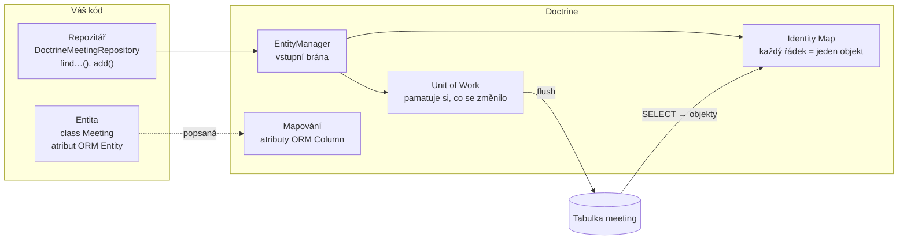
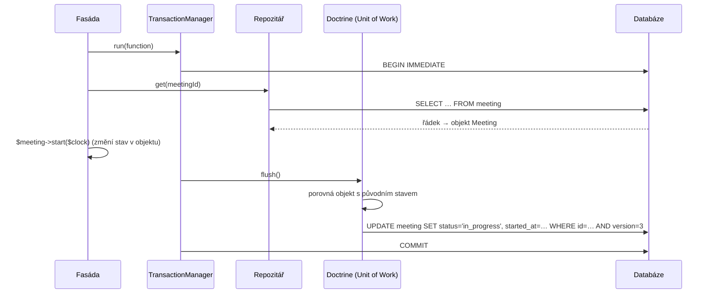
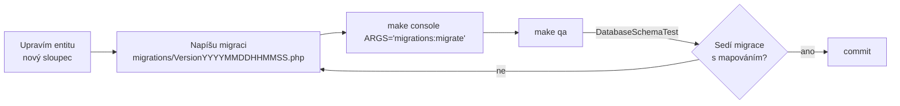

# Doctrine pro začátečníky

Doctrine je knihovna, která **ukládá PHP objekty do databáze**. Místo psaní SQL pracujete s objekty (`Meeting`, `AgendaItem`) a Doctrine sama vygeneruje `INSERT` / `UPDATE` / `SELECT`. V Nette se k ní připojuje přes balíčky `nettrine/*`.

Pokud jste zvyklí na Nette Database (`$db->table('meeting')->where(...)`), hlavní rozdíl je: **nepracujete s řádky, ale s objekty, které mají chování.**

## Hlavní pojmy



| Pojem | Co to je | V Konšelu |
|---|---|---|
| **Entita** | PHP třída, jejíž objekty se ukládají do tabulky | `app/Model/Meeting/Meeting.php` |
| **Mapování** | atributy říkající, který sloupec patří k jaké vlastnosti | `#[ORM\Column(length: 200)] private string $place;` |
| **EntityManager** | objekt, přes který se ukládá a načítá | používají ho jen repozitáře a `TransactionManager` |
| **Repozitář** | třída s dotazy pro jednu entitu | `DoctrineMeetingRepository::findUnfinished()` |
| **flush** | okamžik, kdy Doctrine zapíše všechny změny do DB | volá ho `TransactionManager::run()` |
| **Migrace** | skript, který mění strukturu databáze | `migrations/Version20261117…php` |

## Entita v praxi

```php
#[ORM\Entity]                                // tahle třída je entita
#[ORM\Table(name: 'attendance')]             // tabulka
final class Attendance implements TenantOwned
{
    use IntegerId;                           // sloupec id

    #[ORM\ManyToOne(targetEntity: Meeting::class)]   // vazba: mnoho docházek → jedno zasedání
    #[ORM\JoinColumn(nullable: false, onDelete: 'CASCADE')]
    private Meeting $meeting;

    #[ORM\Column(length: 20, enumType: AttendanceStatus::class)]  // enum uložený jako text
    private AttendanceStatus $status = AttendanceStatus::Unknown;

    #[ORM\Column(nullable: true)]            // DateTimeImmutable → datetime sloupec
    private ?\DateTimeImmutable $arrivedAt = null;

    public function mark(AttendanceStatus $status, \DateTimeImmutable $now): void
    {
        // pravidla: kdy to jde, co se stane – žádné settery
    }
}
```

## Jak se změna dostane do databáze

Nemusíte volat „ulož“. Stačí změnit objekt **uvnitř transakce** a Doctrine při `flush` pozná, co se změnilo (Unit of Work).



- **Nový objekt** se musí jednou předat Doctrine: `$this->repository->add($attendance)` (uvnitř `persist`).
- **Chyba uvnitř transakce** (např. „Zasedání ještě nezačalo“) → rollback, nic se neuloží a uživatel dostane hlášku.
- **Souběžná úprava**: `Meeting` a `AgendaItem` mají `#[ORM\Version]`. Když mezitím někdo jiný uložil novější verzi, `UPDATE … AND version = 3` nic nezmění → Doctrine to pozná a uživatel dostane „Mezitím změnil stejné údaje někdo jiný“.

## Dotazy

Jednoduché dotazy přes `findBy`, složitější přes **QueryBuilder** (DQL – podobné SQL, ale s názvy tříd a vlastností):

```php
$this->entityManager->createQueryBuilder()
    ->select('r', 'i')
    ->from(Resolution::class, 'r')          // třída, ne tabulka
    ->join('r.agendaItem', 'i')             // vlastnost, ne sloupec
    ->where('r.meeting = :meeting')
    ->setParameter('meeting', $meeting)     // předáte objekt, Doctrine si vezme id
    ->orderBy('r.sequence')
    ->getQuery()
    ->getResult();                          // pole objektů Resolution
```

Výjimečně, kde je potřeba atomická operace, se použije čisté SQL přes DBAL – např. přidělování čísel usnesení (`DoctrineNumberingSequenceRepository::allocate`).

## Migrace – jak změnit databázi

Struktura DB se nemění ručně. Každá změna je **migrace** v `migrations/`, spouští se `make console ARGS="migrations:migrate"`. V Konšelu se píší přes vlastní `TableBuilder`, aby fungovaly na SQLite i MySQL:

```php
final class Version20261117120000 extends SchemaMigration
{
    public function up(Schema $schema): void
    {
        $this->createTable('attendance', static function (TableBuilder $table): void {
            $table->id()
                ->foreignKey('meeting_id', 'meeting', onDelete: ReferentialAction::CASCADE)
                ->string('status', 20)
                ->datetime('arrived_at', nullable: true)
                ->unique('meeting_id', 'person_id');
        });
    }
}
```

Postup při změně entity:



Pravidla:
- **Nový povinný sloupec** v existující tabulce = dvě migrace: (1) přidat s výchozí hodnotou, (2) výchozí hodnotu odebrat. (Výjimka: verze `#[ORM\Version]` výchozí hodnotu 1 potřebuje.)
- Čas v názvu migrace musí být novější než poslední.
- `make console ARGS="migrations:diff"` vygeneruje návrh – slouží jen jako předloha.
- Test `DatabaseSchemaTest` ověří, že migrace vytvoří přesně to, co popisují entity.

## SQLite

Vývoj i první provoz běží na **SQLite** (jeden soubor `var/database.sqlite`). Nastavení v `SqlitePragmaMiddleware`: cizí klíče zapnuté, WAL režim, čekání na zámek 5 s a transakce `BEGIN IMMEDIATE` (zápisy se seřadí za sebe místo chyby „database is locked“). Přechod na MySQL bude změna konfigurace v `config/doctrine.neon` – migrace jsou napsané nezávisle na databázi.

## Kde hledat při problému

| Problém | Kde |
|---|---|
| „Column not found“ / „no such column“ | chybí migrace, spusťte `migrations:migrate` |
| `DatabaseSchemaTest` selhává | migrace neodpovídá entitě – porovnejte typy, délky, indexy |
| „The EntityManager is closed“ | dřívější chyba při flush – podívejte se na první výjimku v logu |
| data jiné obce | chybí `TenantOwned` nebo `assertOwned()` v presenteru |
| Tracy lišta → panel Doctrine | všechny SQL dotazy požadavku |
