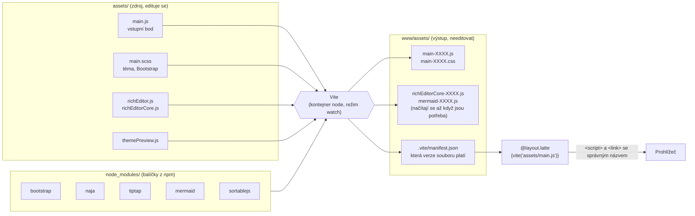
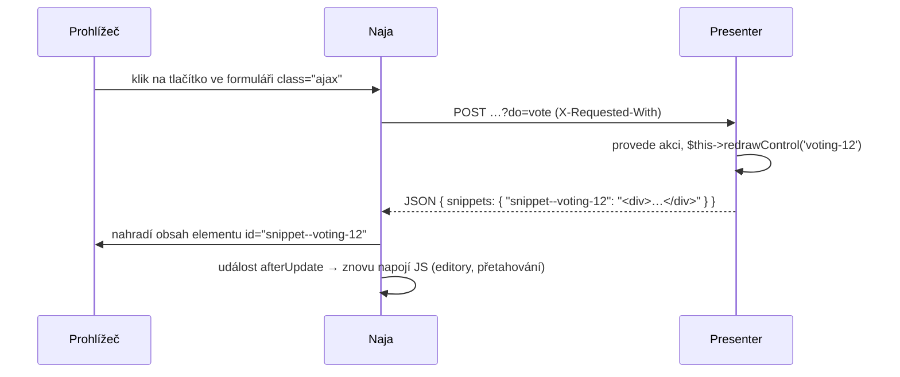

# Frontend: Vite, Bootstrap, Naja

Konšel není SPA – stránky vykresluje server (Nette + Latte). JavaScript jen vylepšuje: AJAXové kliknutí bez načtení stránky, přetahování souborů, editor komentářů, živé náhledy.

## Co je Vite

**Vite** je nástroj, který vezme zdrojové soubory z `assets/` (moderní JavaScript s `import`, SCSS) a **sestaví z nich hotové soubory** pro prohlížeč do `www/assets/`. Je to podobné jako dřív „zkompilovat LESS/SASS a spojit JS“, jen rychlé a automatické.

- Kontejner **node** běží v režimu *watch*: uložíte `main.scss` → za vteřinu je nový `www/assets/main-…css`. Stačí obnovit stránku.
- Názvy souborů obsahují otisk (`main-C51zL2W6.js`), aby prohlížeč nepoužil starou verzi z mezipaměti. Latte funkce `{vite('assets/main.js')}` (třída `ViteAssets`) najde v `manifest.json` aktuální název.
- Velké knihovny (editor TipTap, diagramy Mermaid) jsou v **samostatných souborech** a stahují se až na stránce, která je potřebuje (`await import('./richEditorCore.js')`).
- Jednorázový build: `make assets`. Nový balíček: `make npm ARGS="install --save-exact balicek@verze"`.
- Nastavení je v `vite.config.js`.

## Styly: Bootstrap 5.3 a téma

`assets/main.scss` nastaví proměnné Bootstrapu (barvy, písmo Inter, zaoblení) a pak přidá vlastní komponenty (menu, docházka, hlasování, diskuse…). Pravidla:

- Barvy vždy přes CSS proměnné `var(--bs-primary)`, `var(--bs-body-color)` – funguje tak **tmavý režim** i **barvy obce**.
- **Barvy obce** (Nastavení → Vzhled) se vloží do stránky jako `<style>` s přepsanými proměnnými (`App\UI\Theme\BrandStyle`). Komponenty, které mají v Bootstrapu barvu natvrdo (tlačítka, zaškrtávátka…), jsou v sekci „Barvy obce“ napojené na proměnné.
- Ikony: Bootstrap Icons (`<i class="bi bi-calendar-event">`). Písmo i ikony jsou součástí buildu, žádné CDN.

## Naja: AJAX bez psaní JavaScriptu

**Naja** je knihovna pro Nette: formulář nebo odkaz s třídou `ajax` se odešle na pozadí a server pošle zpět jen změněné kusy stránky (**snippety**).

V Latte se snippet označí `{snippet attendance}…{/snippet}` nebo `n:snippet="voting-{$id}"`. Pozor: Naja mění jen **obsah** snippetu, ne atributy jeho elementu.

## Co dělá který soubor v `assets/`

| Soubor | Co dělá |
|---|---|
| `main.js` | start: Bootstrap, Naja, Nette formuláře; přetahování pořadí bodů (SortableJS), přetahování souborů do diskuse, odpovědi v diskusi, kopírování odkazů, šablony usnesení, průběžné ukládání diskuse, zámky diskuse, obnovování obrazovky průběhu, náhled masky čísel, diagramy v nápovědě |
| `richEditor.js` | najde `textarea[data-rich-editor]` a líně načte editor |
| `richEditorCore.js` | editor komentářů TipTap (tučně, kurzíva, seznamy, odkaz…) |
| `themePreview.js` | živý náhled barev obce v Nastavení → Vzhled |
| `main.scss` | téma a všechny vlastní styly |

## Kontrola vzhledu

`make screenshots PAGES="/admin,/admin/meeting"` vyfotí stránky na desktopu i mobilu (Playwright v Dockeru) do `temp/screenshots/`. Ve stejné složce `docker/screenshots/` jsou i skripty, které aplikaci „proklikají“ v opravdovém prohlížeči:

| Skript | Co ověří |
|---|---|
| `dropzone-check.cjs` | přetažení souboru do diskuse |
| `editor-check.cjs` | editor komentářů, barvy obce |
| `proceedings-check.cjs` | docházka → zahájení → hlasování → diskuse → obnovení stránky |
| `concurrency-check.cjs` | dva prohlížeče: zámek diskuse a průběžná synchronizace |

Spuštění: `docker compose run --rm screenshots sh -c "npm install --silent --prefix /tmp/pw playwright@1.49.1 && node proceedings-check.cjs"`
