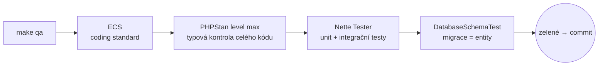

# Testy a kvalita

Před každým commitem musí projít **`make qa`**:



| Nástroj | Co hlídá | Oprava |
|---|---|---|
| ECS | formátování, pořadí `use`, mezery | `make cs-fix` |
| PHPStan (max) | typy, null, neexistující metody, mrtvý kód | ručně podle hlášky |
| Nette Tester | chování | `make test` |

## Druhy testů

```
tests/
├── Unit/              rychlé, bez databáze – pravidla entit a hodnotových objektů
│   ├── Model/Meeting/     QuorumTest, VotingTest, AttendanceTest, ProceedingsTest…
│   ├── Model/People/      NumberingMaskTest
│   └── Model/Shared/      HexColorTest, RichTextTest…
├── Integration/       s databází v paměti – fasády a presentery
│   ├── Model/…            InvitationFacadeTest, ResolutionNumberingTest,
│   │                      NumberingConcurrencyTest (3 procesy najednou), AgendaLockTest…
│   ├── AdminModule/       ProceedingsPresenterTest, BoardTest, ResolutionPresenterTest…
│   ├── PublicModule/      HomepageTest, IdeasTest
│   └── PortalModule/      PortalTest
└── Support/           pomocníci pro testy
    ├── ContainerFactory   DI kontejner s config/test.neon
    ├── Fixtures           obec, uživatel
    ├── MeetingScenario    zastupitelstvo + zasedání + bod
    ├── ResolutionScenario proběhlé zasedání s usneseními ze skutečného hlasování
    ├── PresenterTester    loginAs(), render(), submitForm(), run()
    ├── FakeMailer         zachytí e-maily místo odeslání
    └── FakeAiClient       odpovědi AI bez internetu
```

## Jak vypadá test

```php
test('tie and absent members: 4 for, 4 against of 8 present is rejected', function (): void {
    [, $item, $people, $clock] = votingScene();
    $round = new VotingRound($item, VotingType::Proposal, 'Návrh', null, new Quorum(9, 8), [], $clock->now());
    // … hlasy …
    Assert::same(VotingResult::Rejected, $round->close(new VotingRule(9), $present, $clock->now()));
});
```

V testech platí `config/test.neon`: databáze SQLite v paměti (každý test čistá), hodiny zastavené na **16. 11. 2026 10:00**, falešný mailer a AI.

## Demo data

`app/Console/Demo/DemoSeeder.php` – každá nová funkce do něj přidá ukázková data. Test `DemoSeederTest` hlídá, že seeder na prázdné databázi vždy projde a struktura obce nemá varování.

## Pravidla pro nový kód (zkráceně z CLAUDE.md)

- `declare(strict_types=1)`, třídy `final`, `readonly` kde to jde.
- Presentery jen přes fasády. Entity mají chování, ne settery.
- Každá `action*` / `render*` / `handle*` v administraci má `#[Allowed(...)]`.
- Texty v UI česky a s vykáním, kód anglicky.
- Nová funkce = test + demo data + záznam do Deníku v `doc/todo-v2.md`.
