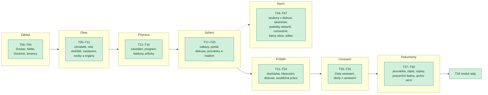

# Plán a stav

Podrobný plán s architektonickými rozhodnutími (ADR) a Deníkem změn je v **`doc/todo-v2.md`**, doménové požadavky v `doc/todo-v1.md`. Tady je přehled.

## Co je hotové (stav 17. 11. 2026)

**MVP (T00–T30 + T34) je hotové**: použitelný systém pro zastupitelstvo i radu – program, sdílení, pozvánky, průběh, usnesení, zápis a dokumenty v PDF a pro Word, včetně archivu uložených verzí a podepsaných originálů.

## Co zbývá

| Task | Co | Poznámka |
|---|---|---|
| T16b | nahrávání souborů nad 64 MB po částech | zatím limit 64 MB |
| T31 | vlastní šablony dokumentů obce | šablony jsou v `resources/documents` |
| T32 | fulltextové vyhledávání (i bez diakritiky) | přehled usnesení už hledá v textu |
| T33 | archiv podle let, plná neměnnost po ověření zápisu, důvod znovuotevření | většina pravidel už v entitách je |
| T35 | ustavující zasedání: slib členů, listina slibu | volba osob už funguje |
| T36 | ARES – údaje obce podle IČO | |
| T37–T38 | AI: návrhy textů bodů a usnesení, analýza příloh | napojení na OpenAI je připravené |
| T39 | audit – kdo co změnil | |
| T40 | přepis zvukového záznamu | |
| T41–T43 | zveřejnění, GDPR, MySQL, nasazení | |

## Známé dluhy

- Texty šablon ustavujícího zasedání musí ověřit člověk proti metodice MV.
- Ruční přečíslování usnesení (akce správce) zatím není.
- Opakované odchody a příchody jednoho člena během zasedání se nepamatují (jen poslední).
- „Moje úkoly“ páruje e-mail uživatele s e-mailem osoby – chybí přímá vazba uživatel ↔ osoba.
- Demo Neplachovic nemá radu (obec s 9 zastupiteli ji podle § 99 nevolí); tok rady ověřuje test `BoardTest`.
- Komentáře občanů na veřejné stránce zatím nejsou; mazání IP adres podnětů po čase (GDPR).
