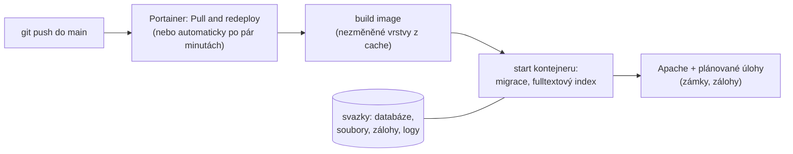
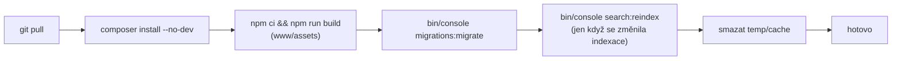

# Nasazení a provoz

## Produkce v Dockeru (Portainer)

Produkční image se sestaví přímo z gitu: `compose.prod.yaml` + `docker/prod/` (multi-stage: Vite build → `composer install --no-dev` → PHP 8.4 s Apachem). Stejně to funguje v Portaineru, na libovolném serveru s Dockerem (`docker compose -f compose.prod.yaml up -d --build`) i na Home Assistantu s doplňkem Portainer.



### Založení stacku

1. Portainer → **Stacks → Add stack**, název `konsel`, Build method **Repository**:
   - Repository URL `https://github.com/731mat/konsel`, reference `refs/heads/main`
   - Compose path `compose.prod.yaml`
   - repozitář je veřejný, Authentication nechte vypnuté
   - volitelně **Automatic updates** → Polling (např. 5 minut): nová verze se nasadí sama po pushi
2. **Environment variables** (Advanced mode, vložit a doplnit):
   ```
   KONSEL_PORT=8090
   KONSEL_APP_URL=https://konsel.matyho.cz
   KONSEL_MAIL_FROM=noreply@konsel.matyho.cz
   KONSEL_SMTP_HOST=smtp.example.cz
   KONSEL_SMTP_PORT=587
   KONSEL_SMTP_USERNAME=…
   KONSEL_SMTP_PASSWORD=…
   KONSEL_SMTP_ENCRYPTION=tls
   ```
3. **Deploy the stack.** První sestavení trvá několik minut (na Raspberry Pi i desítky minut – kompilují se rozšíření PHP), další nasazení jsou rychlá.
4. **Webová instalace:** v Portaineru otevřete kontejner → **Logs** a najděte řádek `Instalace: otevřete https://…/instalace a zadejte instalační kód XXXXX-XXXXX`. Otevřete adresu aplikace – prázdná instalace sama přejde na průvodce:
   1. instalační kód (aby instalaci nedokončil nikdo cizí; kód platí do dokončení, vypíše ho i `konsel install:code`),
   2. kontrola prostředí (rozšíření PHP, zápis do složek, šifrovací klíč, adresa https),
   3. obec – IČO s načtením z ARES, úřední název a adresa,
   4. volební období, zastupitelstvo a případně rada,
   5. moduly, vzorové šablony programu a usnesení, noční zálohy,
   6. účet správce obce → instalace se dokončí najednou a správce je rovnou přihlášený.

   Průvodce je dostupný jen do vytvoření prvního uživatele. Ručně lze instanci založit i v konzoli kontejneru: `konsel municipality:create "Neplachovice" --ico 00300535` a `konsel user:create jmeno@obec.cz "Jméno Příjmení" --role admin -m neplachovice`.
5. Reverzní proxy s HTTPS: `konsel.matyho.cz` → `http://<IP Home Assistantu>:8090`.
   - Nginx Proxy Manager: zapnout SSL (Let's Encrypt) a do Advanced vložit `client_max_body_size 1024m;` a `proxy_read_timeout 600s;` (velké záznamy zasedání).
   - Cloudflare (tunel nebo proxy) má v bezplatném tarifu limit **100 MB na jeden požadavek** – větší záznam přes něj nenahrajete.
   - Připojení AI (MCP) potřebuje, aby proxy propouštěla `/mcp`, `/oauth/*` a `/.well-known/*` a nepřepisovala hlavičku `Authorization`.

Příkaz `konsel …` je `bin/console` spuštěný pod uživatelem webového serveru. V kontejneru nepoužívejte `php bin/console` jako root – soubory v `temp/` by pak web nemohl přepsat.

### Proměnné prostředí

| Proměnná | Výchozí | K čemu |
|---|---|---|
| `KONSEL_PORT` | `8090` | port na hostiteli |
| `KONSEL_APP_URL` | `https://konsel.matyho.cz` | veřejná adresa (odkazy v e-mailech); u `https://` aplikace posílá HSTS |
| `KONSEL_MAIL_FROM` | `noreply@konsel.matyho.cz` | odesílatel e-mailů |
| `KONSEL_SMTP_HOST`, `_PORT`, `_USERNAME`, `_PASSWORD` | – / `587` | SMTP server – bez něj neodejdou pozvánky ani odkazy |
| `KONSEL_SMTP_ENCRYPTION` | `tls` | `tls`, `ssl` nebo `none` |
| `KONSEL_ENCRYPTION_KEY` | prázdné | šifrovací klíč pro API klíče v DB; prázdné = vygeneruje se při prvním startu do `var/encryption.key` |
| `KONSEL_TRUSTED_PROXIES` | privátní sítě | adresy proxy, od kterých aplikace věří hlavičkám `X-Forwarded-*` (https, IP návštěvníka) |
| `KONSEL_ERROR_EMAIL` | prázdné | e-mail, kam Tracy pošle upozornění na chybu aplikace |
| `KONSEL_BACKUP_DIR` | svazek `konsel-backups` | cesta na hostiteli pro zálohy (viz níže) |

Proměnné přebíjí `config/local.neon` (načítá je `App\Core\Config\EnvironmentConfig`). Debug režim je vypnutý, dokud není `NETTE_DEBUG=1`.

### Co se děje při startu kontejneru

1. práva svazků pro webový server, šifrovací klíč (jen poprvé)
2. `migrations:migrate` – databáze se sama převede na novou verzi
3. `search:reindex` – fulltextový index
4. u prázdné instalace vypíše adresu průvodce a instalační kód (`install:code`)
5. na pozadí plánované úlohy každých 10 minut: `locks:cleanup`, `ai-access:cleanup` a `backup:run --scheduled` (systémový cron není potřeba)
6. Apache

### Svazky a zálohy

| Svazek | V kontejneru | Obsah |
|---|---|---|
| `konsel-data` | `/app/var` | `database.sqlite`, `storage/` (přílohy, záznamy), `sessions/`, `encryption.key` |
| `konsel-backups` | `/app/var/backups` | zálohy z Nastavení → Zálohy |
| `konsel-log` | `/app/log` | chyby aplikace (`exception.log`, detail chyb) |

Zálohy Home Assistantu svazky Dockeru **neobsahují**. Na Home Assistant OS nastavte `KONSEL_BACKUP_DIR=/mnt/data/supervisor/share/konsel-zalohy` – zálohy Konšelu pak leží ve složce `share` (přístupná přes doplněk Samba a součást záloh HA, pokud zálohujete složku share). Šifrovací klíč (`cat /app/var/encryption.key` v konzoli kontejneru) si uložte bokem nebo ho nastavte do `KONSEL_ENCRYPTION_KEY` – bez něj by po obnově na jiném serveru bylo nutné znovu zadat klíč k AI.

Logy startu a Apache: Portainer → kontejner → **Logs**.

## Konfigurace (bez Dockeru)

Na vlastním serveru bez Dockeru patří tajnosti a nastavení do `config/local.neon` (není v gitu, předloha `config/local.neon.dist`):

```neon
parameters:
	# šifrovací klíč pro API klíče v DB – vygenerujte: make console ARGS="app:encryption-key"
	# po nasazení neměnit, uložené klíče by nešly dešifrovat
	encryptionKey: '…'

	# veřejná adresa (odkazy v e-mailech z konzole)
	appUrl: 'https://konsel.matyho.cz'

	# odesílatel a SMTP server
	mailFrom: 'noreply@konsel.matyho.cz'
	smtp:
		host: smtp.example.cz
		port: 587
		username: '…'
		password: '…'
		encryption: tls
```

## Limity nahrávání (PHP)

Zvukové záznamy zasedání mají až 500 MB na soubor. Na serveru proto musí být (vývoj: `docker/php/php.ini`, po změně `make build && make up`; produkční image: `docker/prod/php.ini`):

```ini
upload_max_filesize = 500M
post_max_size = 1024M   ; jedno odeslání může mít víc souborů
max_input_time = 600
```

Přílohy bodů hlídá vlastní limit aplikace (64 MB, parametr `attachmentMaxSize`). Pokud je před aplikací nginx/proxy, nastavte i `client_max_body_size 1024m`.

## Po nasazení nové verze (bez Dockeru)

V produkčním kontejneru se migrace a index provedou samy při startu, temp je v každém kontejneru nový.



## Pravidelné úlohy (cron)

Produkční kontejner je spouští sám (každých 10 minut). Na serveru bez Dockeru:

| Kdy | Příkaz | Proč |
|---|---|---|
| každých 10 minut | `bin/console locks:cleanup` | úklid vypršelých zámků bodů |
| každý den | `bin/console ai-access:cleanup` | úklid prošlých připojení AI a registrací aplikací |
| každou hodinu | `bin/console backup:run --scheduled` | pravidelná záloha – proběhne, jen když je podle plánu v Nastavení → Zálohy na řadě |

## Zálohy

V aplikaci: **Nastavení → Zálohy** (správce systému; správce obce jen v instalaci s jedinou obcí – záloha obsahuje celou databázi).

- Plán: zapnout, četnost (denně / týdně / měsíčně), hodina, den, co zálohovat (databáze + soubory / jen databáze), kolik posledních záloh držet.
- **Zálohovat teď**, seznam záloh se **stažením** a smazáním.
- Záloha = ZIP ve `var/backups/`: `database.sqlite` (konzistentní kopie přes `VACUUM INTO`, jde i za provozu), u kompletní zálohy složka `storage` a `manifest.json`.
- Spouštění plánu: cron každou hodinu `bin/console backup:run --scheduled` (zmeškaný termín se dožene při dalším spuštění). Ručně `bin/console backup:run [--db-only]`, ve vývoji `make backup`.
- Zálohy leží na stejném serveru – kopírujte je i jinam (stažení z aplikace nebo synchronizace `var/backups`).

Obnova (jen správce serveru): zastavit aplikaci, `database.sqlite` ze zálohy na místo `var/database.sqlite` (smazat `-wal`, `-shm`), u kompletní zálohy nahradit `var/storage`, spustit `migrations:migrate` a `search:reindex`.

## Kde hledat chyby

| Co | Kde |
|---|---|
| chyby aplikace | `log/exception.log` a HTML detail v `log/` |
| SQL dotazy, čas, paměť | Tracy lišta (jen ve vývoji) |
| odeslané e-maily | Mailpit http://localhost:8025 (vývoj), přehled odeslaných e-mailů u zasedání |
| e-mail neodešel | Pozvánky a odkazy → Odeslané e-maily (sloupec Stav) |
