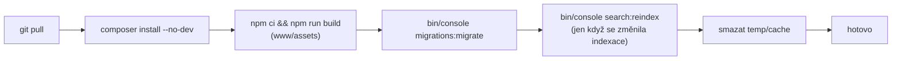

# Nasazení a provoz

## Konfigurace

Tajnosti a nastavení konkrétního serveru patří do `config/local.neon` (není v gitu, předloha `config/local.neon.dist`):

```neon
parameters:
	# šifrovací klíč pro API klíče v DB – vygenerujte: make console ARGS="app:encryption-key"
	# po nasazení neměnit, uložené klíče by nešly dešifrovat
	encryptionKey: '…'

	# veřejná adresa (odkazy v e-mailech z konzole)
	appUrl: 'https://konsel.matyho.cz'

	# odesílatel a SMTP server
	mailFrom: 'noreply@konsel.matyho.cz'
	smtp:
		host: smtp.example.cz
		port: 587
		username: '…'
		password: '…'
		encryption: tls
```

## Limity nahrávání (PHP)

Zvukové záznamy zasedání mají až 500 MB na soubor. Na serveru proto musí být (vývoj: `docker/php/php.ini`, po změně `make build && make up`):

```ini
upload_max_filesize = 500M
post_max_size = 1024M   ; jedno odeslání může mít víc souborů
max_input_time = 600
```

Přílohy bodů hlídá vlastní limit aplikace (64 MB, parametr `attachmentMaxSize`). Pokud je před aplikací nginx/proxy, nastavte i `client_max_body_size 1024m`.

## Po nasazení nové verze



## Pravidelné úlohy (cron)

| Kdy | Příkaz | Proč |
|---|---|---|
| každých 10 minut | `bin/console locks:cleanup` | úklid vypršelých zámků bodů |
| každou hodinu | `bin/console backup:run --scheduled` | pravidelná záloha – proběhne, jen když je podle plánu v Nastavení → Zálohy na řadě |

## Zálohy

V aplikaci: **Nastavení → Zálohy** (správce systému; správce obce jen v instalaci s jedinou obcí – záloha obsahuje celou databázi).

- Plán: zapnout, četnost (denně / týdně / měsíčně), hodina, den, co zálohovat (databáze + soubory / jen databáze), kolik posledních záloh držet.
- **Zálohovat teď**, seznam záloh se **stažením** a smazáním.
- Záloha = ZIP ve `var/backups/`: `database.sqlite` (konzistentní kopie přes `VACUUM INTO`, jde i za provozu), u kompletní zálohy složka `storage` a `manifest.json`.
- Spouštění plánu: cron každou hodinu `bin/console backup:run --scheduled` (zmeškaný termín se dožene při dalším spuštění). Ručně `bin/console backup:run [--db-only]`, ve vývoji `make backup`.
- Zálohy leží na stejném serveru – kopírujte je i jinam (stažení z aplikace nebo synchronizace `var/backups`).

Obnova (jen správce serveru): zastavit aplikaci, `database.sqlite` ze zálohy na místo `var/database.sqlite` (smazat `-wal`, `-shm`), u kompletní zálohy nahradit `var/storage`, spustit `migrations:migrate` a `search:reindex`.

## Kde hledat chyby

| Co | Kde |
|---|---|
| chyby aplikace | `log/exception.log` a HTML detail v `log/` |
| SQL dotazy, čas, paměť | Tracy lišta (jen ve vývoji) |
| odeslané e-maily | Mailpit http://localhost:8025 (vývoj), přehled odeslaných e-mailů u zasedání |
| e-mail neodešel | Pozvánky a odkazy → Odeslané e-maily (sloupec Stav) |
