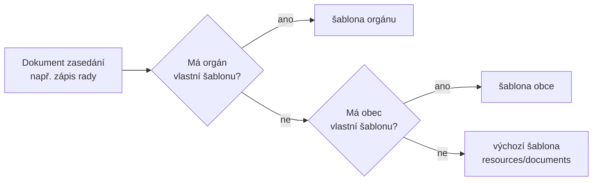
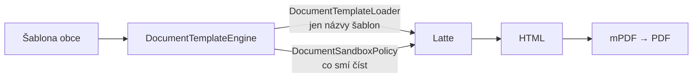

# Šablony dokumentů

Pozvánka, podklady, zápis, usnesení, prezenční listina i výpis z usnesení se tvoří z **HTML šablon** (Latte) a převádějí se do PDF. Obec si každou šablonu může upravit v **Nastavení → Dokumenty** – bez programátora a bez Wordu.

## Která šablona se použije

Stejně se hledá i **společná hlavička** (`@layout.latte`) – logo, údaje obce, písmo a styly pro všechny dokumenty.

## Jak upravit šablonu

1. Nastavení → Dokumenty → **Upravit** u dokumentu.
2. Nahoře zvolte, pro koho šablona platí: celá obec, nebo jeden orgán.
3. Editor je předvyplněný současnou podobou. Upravte HTML a texty.
4. **Náhled PDF** ukáže dokument na posledním vhodném zasedání (nic se neukládá).
5. **Uložit šablonu** – před uložením proběhne kontrola (viz níže). Nové dokumenty se hned tvoří podle ní.
6. **Obnovit výchozí** smaže vlastní šablonu.

Archivní verze dokumentů (Dokumenty → Archiv) se změnou šablony nemění.

## Co v šabloně může být

| Zápis | K čemu |
|---|---|
| `{$meeting->getPlace()}` | výpis údaje (vždy bezpečně escapovaný) |
| `{if $mayor}…{/if}` | podmínka |
| `{foreach $meeting->getAgendaItems() as $item}…{/foreach}` | cyklus |
| `{$meeting->getScheduledAt()|czDateLong}` | „středa 9. prosince 2026 v 18:00 hodin“ |
| `|czDate`, `|czDateTime`, `|genitiveBody` | datum, datum a čas, „Zastupitelstva obce …“ |
| `{$present|names|period}` | „Ing. Jan Dvořák, Marie Svobodová.“ (tečka jen když chybí) |
| `{var $kratke = $items|where: fn($i) => $i->getProposedResolution()}` | výběr z pole podmínkou |
| `|breakLines`, `|nl2p`, `|upper`, `|firstUpper`, `|truncate: 80` | práce s textem |
| `{layout '@layout.latte'}` + `{block content}…{/block}` | dokument se společnou hlavičkou |

Seznam údajů, které má konkrétní dokument k dispozici, je v editoru vpravo.

## Vzory

V `resources/documents/samples/` jsou hotové šablony obcí ke zkopírování do editoru:

| Soubor | Co to je |
|---|---|
| `resolutions-neplachovice.latte` | Usnesení ve formátu obce Neplachovice: „19/2/1 – **Schvaluje:** …“, podbody jednoho bodu pohromadě, účast členů a občanů, podpis starosty a místostarosty. Demo ho má nastavené. |

## Kontrola při uložení

- **Povinné náležitosti** – např. zápis musí obsahovat přítomné (`$attendance`), pořad jednání, hlasování a usnesení (§ 95 zákona o obcích), pozvánka datum, místo a program (§ 93). Chybějící se vypíší.
- **Zápis šablony** – neuzavřený `{if}` apod. se ohlásí i s číslem řádku.
- **Zkušební vykreslení** na skutečném zasedání obce.

## Bezpečnost: sandbox

Šablonu píše správce obce, přesto se vykresluje v **sandboxu Latte** (`App\Model\Document\DocumentSandboxPolicy`). Šablona smí údaje jen **číst**:

- povolené jsou jen getry vybraných objektů (zasedání, bod, orgán, osoba, usnesení, hlasování, docházka, číselníky) – žádné metody, které mění data;
- žádné `{php}`, systémové funkce, `|noescape`, funkce volané podle názvu (`array_map("…")`);
- `{layout}` a `{include}` načtou jen jiné šablony dokumentů, nikdy soubor na disku.

**Pro vývojáře:** nový objekt nebo údaj v dokumentu = přidat třídu do `DocumentSandboxPolicy::Classes` (getry se povolí samy) a do nápovědy `DocumentTemplateType::variables()`. Ve výchozích šablonách nepoužívejte `array_map`/`array_filter` – na to jsou filtry `|where` a `|names` a metody jako `AttendanceOverview::withStatus()`. Test `DocumentTemplateTest` ověří, že všechny výchozí šablony v sandboxu projdou.
