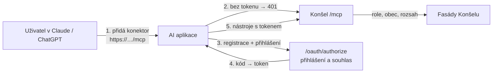

# Připojení AI asistentů (MCP)

Konšel je **server MCP** (Model Context Protocol). Každý uživatel úřadu si k němu může připojit svého AI asistenta – Claude, ChatGPT, Claude Code, Cursor a další klienty s podporou MCP. Asistent pak umí vyhledávat v zasedáních, usneseních a plánech, číst program a podklady a s výslovným svolením i připravovat body programu nebo psát připomínky.

**Asistent jedná jménem uživatele:** vidí a smí jen to, co uživatel podle své role, jen v jeho obci a jen v rozsahu, který povolil. Každá změna se zapíše do historie změn jako „Jana Nováková (AI: Claude)“.

## Pro uživatele

Menu u jména vpravo nahoře → **Připojení AI**:

- adresa serveru (`https://konsel.matyho.cz/mcp`) a návod pro Claude, ChatGPT a Claude Code,
- **Moje připojení** – připojené aplikace a osobní tokeny, kdy byly naposledy použity, tlačítko Odpojit,
- **Nový osobní token** – pro aplikace bez přihlášení přes prohlížeč (hlavička `Authorization: Bearer ksl_…`), platnost 30 dní až 1 rok, ukáže se jen jednou,
- správce obce navíc vidí **připojení ostatních uživatelů** a může je odpojit.

Připojení v Claude: Nastavení → Konektory → Přidat vlastní konektor → adresa serveru → Připojit → v Konšelu se přihlásit a **Povolit připojení**. Zaškrtnutím „Povolit i změny“ dostane asistent i nástroje pro zápis.

Modul lze pro obec vypnout v **Nastavení → Moduly** (Připojení AI asistentů). Vypnutím přestanou platit všechna připojení obce (data připojení zůstanou).

## Co asistent umí

| Nástroj | Co dělá | Potřebná oprávnění |
|---|---|---|
| `get_overview` | obec, orgány, nejbližší a poslední zasedání, počty úkolů a plánů | každý |
| `search` | fulltext v zasedáních, bodech, usneseních, připomínkách, plánech | čtení zasedání |
| `list_meetings`, `get_meeting` | seznam a detail zasedání s programem, funkcemi, docházkou, usneseními | čtení zasedání |
| `get_agenda_item` | bod celý: důvodová zpráva, návrh usnesení, diskuse, přílohy, připomínky, hlasování | čtení programu |
| `get_document` | text pozvánky, podkladů, zápisu, usnesení, prezenční listiny | čtení dokumentů |
| `list_resolutions`, `get_resolution` | usnesení se zněním, hlasováním a úkoly | čtení usnesení |
| `list_tasks` | úkoly z usnesení (otevřené, moje, po termínu) | modul Úkoly z usnesení |
| `list_projects`, `get_project` | plány obce s vláknem | modul Plány |
| `list_people` | členové orgánů a osoby s ID (bez kontaktů) | čtení osob |
| `create_meeting` | založí zasedání v přípravě | úprava zasedání + změny |
| `create_agenda_item`, `update_agenda_item` | přidá / upraví bod programu zasedání v přípravě | úprava programu + změny |
| `add_comment` | připomínka k bodu nebo do diskuse plánu | změny |
| `create_project`, `change_project_status` | plán obce a jeho fáze | úprava plánů + změny |
| `add_resolution_task`, `update_resolution_task` | úkol z usnesení, splnění / zrušení | úprava usnesení + změny |

Záměrně **chybí**: hlasování, docházka, změny stavu zasedání, schválení zápisu, rozesílání pozvánek, mazání, nastavení a uživatelé. Nástroje se v seznamu (`tools/list`) ukazují jen ty, které uživatel s daným připojením smí použít.

## Jak to funguje uvnitř

| Část | Kde |
|---|---|
| Endpoint MCP (`POST /mcp`, Streamable HTTP, JSON odpovědi, bez relací) | `app/ApiModule/Mcp/McpPresenter.php`, protokol `McpServer` (verze 2025-11-25 až 2024-11-05) |
| Nástroje | `app/ApiModule/Mcp/Tool/*Tool.php` – registrují se samy, pracují jen přes fasády |
| Oprávnění nástroje | `ToolDefinition` (zdroj ACL, privilegium, modul, zápis) + `McpContext::allows()`; entity podle ID vždy přes `McpContext::owned()` |
| Tokeny, OAuth | `app/Model/AiAccess/` – `AiAccessToken` (osobní / aplikace, jen hashe), `OAuthClient`, `AuthorizationCode`, `AiAccessFacade`, `OAuthFacade` |
| OAuth endpointy | `app/ApiModule/OAuth/OAuthPresenter.php`: `/.well-known/oauth-protected-resource`, `/.well-known/oauth-authorization-server`, `/oauth/register`, `/oauth/token`, `/oauth/revoke` |
| Souhlas uživatele | `Admin:AiConnection:authorize` na `/oauth/authorize` (přihlášení, souhlas, PKCE S256) |

Pravidla OAuth 2.1: jen authorization code s PKCE S256, registrace aplikací veřejná (RFC 7591 – tak to MCP vyžaduje), přístupový token 1 hodina, obnovovací 90 dní a při obnovení se vymění, návratová adresa musí přesně odpovídat registraci (u localhostu nezáleží na portu), `http://` jen pro localhost. Úklid prošlých kódů, odvolaných připojení a nepoužitých registrací: `bin/console ai-access:cleanup` (produkční kontejner ho spouští sám).

**Nový nástroj:** třída `app/ApiModule/Mcp/Tool/XxxTool.php` implementující `McpTool`, v `definition()` název, český popis pro AI, JSON Schema parametrů a oprávnění (`Resource`, `Privilege`, `writes`, `module`). V `call()` jen fasády, entity podle ID přes `$context->owned()`, chyby pro AI jako `ToolException`. Přidat test do `tests/Integration/ApiModule/McpTest.phpt` a řádek do tabulky výše.
